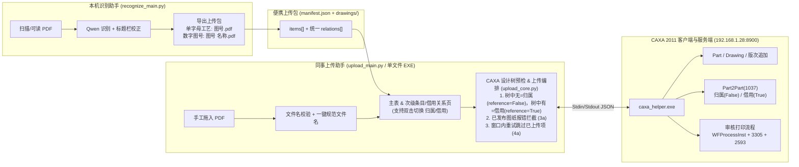

# CAXA 图纸工具架构评审与代码修订报告

本报告针对 `REVIEW_REQUEST.md` 提出的 9 项核心架构问题、交付格式与现场约束编写，并已结合双方确认的业务规则（**1a / 2b+一键改名 / 3a / 4a / 局域网精简**）同步完成了 `01_source/app` 源码修订与单元测试验证。

## 1. 已确认的核心问题与风险（按严重度排序）

下表汇总了基于原始评审包源码（`01_source/app`）、抓包分析（`02_docs/caxa_workflow_capture_analysis_20261105.md`）及真实节点探测数据（`04_tests/probe_new_drawing_nodes.json`）确认的核心缺陷与风险，以及在本次修订包中的处置状态：

| 严重度 | 问题与风险描述 | 原始代码位置与包内证据 | 实际后果 | 本次修订包处置状态 |
| :--- | :--- | :--- | :--- | :--- |
| **P0** | **`CmdStartWorkflow` 捕获异常后仍返回 `Ok(result)`** | `caxa_helper.cs:2006-2010`、`bridge.py:67`、`upload_core.py:225` | 流程创建后若挂接 `3305` 文档关系、指派审核人或 `start()` 抛异常，C# 返回 `{"ok": true, "error": "..."}`，Python 端不会抛错，反而提示“流程已发起”，留下未启动或漏挂图纸的孤儿流程。 | **已修复**（`caxa_helper.cs` 改为返回 `Err(...)` 并保留 `created_process_instance_id` 供排查）。 |
| **P0** | **`_import_legacy_relations` 将三套关系混入 `relations` 导致重复借用与过滤失效** | `upload_main.py:424-439`、`upload_core.py:182-210` | 打开上传包时，`assemblies`（Z03 明细表）与 `manual_borrows` 被全部追加进 `relations`。上传时先遍历 `assemblies` 调 `borrow_missing_components`，又遍历 `relations` 调 `borrow_under`，导致 BOM 借用被重复执行两遍，且绕过了 `03.GPZ.` 钢瓶组禁借用和 `item["borrow"]=False` 过滤。 | **已修复**（在 `drawing_bundle.py` 新增 `normalize_manifest_relations` 统一去重归一化，并在入表时过滤 `03.GPZ.`）。 |
| **P0** | **次级条目未区分“归属子件 (`reference=False`)”与“借用 (`reference=True`)”** | `uploader.py:227-235`、`upload_core.py:209`、`probe_new_drawing_nodes.json` | 真实设计树中 `01.59.OV.03` 下属子件 `01.59.OV.03-01~-09` 全部为 `reference=False`（归属），整机 `03.OV.04-05030` 下属组件才为 `reference=True`（借用）。原代码对人工次级条目一律调 `borrow_under(reference=True)`，导致同级子件关系属性混乱。 | **已修复**（按规则 **1a** 实现离线前缀初判 + CAXA 设计树预检“树中无=归属、树中有=借用” + 界面双击切换勘误）。 |
| **P1** | **“已发布”状态图纸执行 `append_iteration` 失败后静默回退为 `reuse`** | `caxa_helper.cs:1353-1361, 1531-1545`、`probe_new_drawing_nodes.json` | 处于“发布”状态的图纸不允许追加版次；原代码在挂接返回 `null` 时静默走 `append_iteration_fallback_reuse` 返回 `attached=true, reused=true`，使旧图纸被误认为升版成功并进入后续流程。 | **已修复**（按规则 **3a** 在 `uploader.py` 与 `caxa_helper.cs` 双端预检“发布”状态直接报错拦截，并校验上传前后 `history_count/iterator_no` 递增）。 |
| **P1** | **单字母工艺文档与数字图号命名规则冲突，误放行 `ZJ03.*` 且不支持括号 `()`** | `drawing_bundle.py:15, 54`、`extract.py:173, 359`、`uploader.py:183` | ① 原代码要求所有拖入文件带空格和中文名，但 CAXA 中单字母工艺文档（`Z03/M03/T03/J03/P03`）实际不带中文名；② 误将错误前缀 `ZJ03.*` 当作合法工艺文档；③ `CODE_RE` 不支持含 `()` 的合法图号（如 `01.55.04.45E(L)DN40-XS-304`）。 | **已修复**（按规则 **2b+** 统一正则，支持 `()`，标红拦截 `ZJ03.*`，单字母工艺不带中文名，并在上传端新增“一键规范文件名”按钮）。 |
| **P1** | **`bridge.py:_restart_and_relogin` 重连登录未消费 stdout 响应行** | `caxa/bridge.py:76-81` | helper 异常退出重拉起时，`_restart_and_relogin` 仅调用 `_send_raw(self._login_params)` 而未调用 `_readline()` 读取登录返回行，导致后续业务命令读到登录响应而发生协议错位。 | **已修复**（重连登录后同步读取并校验登录响应 JSON）。 |
| **P1** | **窗口内重试时丢失已上传图纸的 `drawing_id` 与 `batch_codes`** | `upload_core.py:82-116, 225` | 批次部分失败后不关窗口重试时，原代码仅收集本次重试项的 `drawing_ids`，导致重试成功后发起的“审核打印”流程漏掉第一次已上传成功的图纸。 | **已修复**（按规则 **4a** 汇总本批全部 `已上传` 条目的 `drawing_id` 与 `batch_codes`，跳过已完成项）。 |
| **P2** | **双击编辑条目未同步 `relations`、冗余 `server_main.py` 及 C 盘路径硬编码** | `upload_main.py:725-742`、`server_main.py`、`caxa_helper.cs:12-17` | 双击修改父图号后未更新 `self.relations`；存在不再使用的局域网服务端代码；D 盘安装 CAXA 时无法加载 DLL。 | **已修复**（同步更新 `relations`、删除 `server_main.py` 及相关脚本、`ProbeDirs` 扩展 C/D/E 盘探测）。 |

## 2. 针对 `REVIEW_REQUEST.md` 九大核心问题的逐项解答

### 问题 1：当前“本机识别端 + 可独立分发的上传端 + 上传包协议”的模块边界是否合理？
- **评审结论**：**核心边界合理，完全契合现场单机识别与同事分发上传的业务分工**。
  - **识别端（`recognize_main.py`）**：留在具备本地 Qwen 视觉服务与 Python 环境的机器上运行，承担 PDF 拆页（`pypdf`）、页面渲染（`pypdfium2`）、视觉转录、标题栏放大重识别与 Z03 明细表提取。
  - **上传端（`upload_main.py` / `图纸上传助手.exe`）**：彻底剥离 `pipeline`、`PIL`、`pypdf`、`pdfplumber` 等重依赖，仅保留 Tkinter + `tkinterdnd2` + `caxa_helper.exe`，既能导入识别端导出的 `manifest.json + drawings/*.pdf` 上传包，也能直接拖入手工整理好的 PDF。
- **边界收敛与清理（已落地）**：
  - **统一规则真源**：将图号合法性校验、单字母工艺文档判定、标准文件名生成统一收敛到无第三方依赖的 `drawing_bundle.py`，消除识别端与上传端各自维护正则导致的规则不一致。
  - **下线冗余服务端模式**：鉴于现场采用“识别端导出上传包 / 同事独立上传”模式，已直接删除 `server_main.py` 及对应的 `启动中央助手服务.bat`、`客户端启动.bat`，减少维护负担。

### 问题 2：`relations`、`manual_borrows`、`assemblies` 三套关系数据应如何统一？
- **评审结论**：**将三套关系及条目内的 `parent_code / borrow_to` 统一归一化到 `manifest["relations"]` 列表中，并增加 `link_type`（归属/借用）、`source`（来源）与 `manual_override`（人工勘误锁）三个字段**。
- **统一关系结构**：
  ```json
  {
    "parent_code": "01.59.OV.03",
    "child_code": "01.59.OV.03-03",
    "link_type": "own",
    "source": "drag",
    "manual_override": false,
    "link_status": "已归属"
  }
  ```
- **三种来源的归一化与规则区分（规则 1a）**：
  1. **离线初判规则（`default_link_type`）**：
     - 父级为 `03.*` 整机时（含 `assemblies` 的 Z03 总装明细表）：固定为 `"borrow"`（借用，`reference=True`），且对 `03.GPZ.` 钢瓶组自动过滤不入表。
     - 子件在本批上传 PDF 中，且图号以父级图号为前缀（如 `01.59.OV.03-03` 挂于 `01.59.OV.03`）：离线默认初判为 `"own"`（归属子件，`reference=False`）。
     - 手工输入的设计树已有图号或跨前缀图号：离线默认初判为 `"borrow"`（借用，`reference=True`）。
  2. **连接 CAXA 设计树自动校准（`refine_relations_from_tree`）**：
     - 点击界面**“检查上传包/设计树预检”**或开始上传时，程序查询 CAXA 设计树（`find_part(child_code)`）：**原 CAXA 设计树中不存在该子件时自动设为 `"own"`（归属子件，上传时新建 Part 并建 `reference=False` 链接）；原设计树中已存在时自动设为 `"borrow"`（借用，建 `reference=True` 链接）**。
  3. **人工勘误优先**：
     - 用户在“次级条目 / 借用关系”页双击任意关系行（或点“切换 归属子件 / 借用”按钮），即可在 `"own"` 与 `"borrow"` 之间切换并置 `manual_override = True`，后续自动预检不会覆盖人工勘误结果。

### 问题 3：CAXA 不具备跨对象事务，上传、借用、流程发起分别可能成功后失败，如何安全重试？
- **评审结论**：鉴于服务器与客户端处于同一局域网内，网络稳定性高，无需引入复杂的外部数据库或重型事务框架，采用**“窗口内轻量状态机重试（规则 4a）+ CAXA 读后写（Read-Before-Write）幂等检查 + 失败阻断流程”**即可安全闭环：
  1. **条目级与关系级状态标记**：
     - 每张图纸上传成功后，内存中的 `item["status"]` 立即置为 `"已上传"` 并记录返回的 `item["drawing_id"]`。
     - 每条父子关系建立成功后，内存中的 `rel["link_status"]` 立即置为 `"已归属"` / `"已借用"` / `"已存在"`。
  2. **窗口内安全重试（规则 4a）**：
     - 当某张图纸因处于“发布”状态、整机缺失或命名问题失败时，其它正常图纸照常完成上传；但因为 `failures` 非空，程序严格阻止自动发起“审核打印”流程。
     - 用户在当前窗口内修正失败项（或取消勾选失败项）后再次点击**“上传图纸”**时，程序自动跳过 `status == "已上传"` 的图纸和 `link_status` 已完成的关系，不会重复追加版次；同时自动将首次已成功上传图纸的 `drawing_id` 合并进本批 `drawing_ids` 集合，确保全部成功后发起的“审核打印”流程包含整批完整图纸。
  3. **CAXA 侧幂等保护**：
     - **Part 创建**：先 `find_part(code)`，存在则直接复用 `object_id`，不重复创建。
     - **Part2Part 链接**：调 `part_info` 检查 `link_endpoints` 中是否已有 `roleB.object_id == child_id`，已有则直接记为 `"已存在"` 跳过。

### 问题 4：对旧版 CAXA 2011 的 COM/.NET 接口，应继续采用 Python 拉起的 helper 子进程，还是改成服务、CLI 或插件？
- **评审结论**：**继续采用 Python 按需拉起的受控长连接 `caxa_helper.exe` 子进程（Stdin/Stdout JSON 行协议）是最佳方案**。
- **方案对比**：

| 集成形态 | 可维护性 | 部署成本 | 故障恢复与性能 | 现场适配结论 |
| :--- | :--- | :--- | :--- | :--- |
| **Python 拉起长连接 Helper 子进程（当前方案）** | **高**（单进程单会话，与 UI 生命周期一致） | **极低**（随单文件 EXE 释放，零配置） | **高**（一次登录复用整个批次连接，崩溃可自动重连） | **推荐保留并加固** |
| **常驻本地服务（Windows Service / HTTP）** | 中（需管端口冲突、多会话锁） | 高（触发防火墙弹窗，且 Session 0 隔离无法操作 CAXA 弹窗） | 低（COM STA 线程卡死后需重启服务） | 不适合（破坏弹窗确认与零安装分发） |
| **单次 CLI（每条命令起停一次进程）** | 高 | 低 | 差（每次命令均需重连 8900 端口登录，单批几十张图耗时成倍增加） | 不适合批量操作 |
| **CAXA 内部插件（Add-in）** | 低（受制于 2011 版 .NET 4.0 x86 宿主） | 高（需修改每台同事电脑注册表与安装目录） | 低（异常直接导致 CAXA 客户端闪退） | 不适合同事分发 |

- **已落地的 Helper 稳定性加固**：
  1. 修复了 `caxa/bridge.py:_restart_and_relogin` 重拉起进程后未读取 `login` 响应行导致的管道错位 Bug。
  2. 扩展了 `caxa_helper.cs` 的 `ProbeDirs`，自动探测 `C:\`、`D:\`、`E:\` 下的 `Program Files (x86)` 与 `Program Files` CAXA 2011r3 接口目录。

### 问题 5：如何处理中文 UI 弹窗自动点击与“已发布”状态图纸拦截？
- **评审结论**：
  1. **前置拦截“已发布”状态图纸（规则 3a）**：
     - 处于“发布”状态的图纸在 CAXA 中不能追加新版次。我们在 `caxa/uploader.py:attach_file`（调用 `part_drawings` 检查 `state` 字段）和 `caxa_helper.cs:CmdUpload`（检查 `de.StateExt`）双端加入了前置拦截：一旦发现目标零件下已有同名/同图号图纸处于**“发布”**状态且策略为 `append_iteration`，**在触发导入弹窗前直接报错返回 `失败：图纸已发布，无法追加版次`**，既避免了无效弹窗卡死，又确保即便未重新编译 `caxa_helper.exe` 也能由 Python 端直接拦截。
  2. **上传前后版次递增校验（消除假升版）**：
     - 移除了原 `caxa_helper.cs:1531-1545` 无条件静默回退为 `append_iteration_fallback_reuse` 的逻辑。
     - 在调用 `AttachFile` 前记录已有图纸的 `before_history_count` 与 `before_iterator_no`；调用结束后重新读取 `after_history_count` 与 `after_iterator_no`，只有确认历史记录数增加或版次号变化时才判定 `append_iteration` 成功，否则明确报错“追加新版次失败：版次未增加”。

### 问题 6：上传包是否需要 schema 校验、签名、版本迁移和内容哈希？
- **评审结论**：在同局域网内部流转场景下，**不需要引入数字签名或加密验签**，保持如下轻量可维护机制即可：
  - **保留基础 Schema 与版本字段**：`manifest.json` 校验 `schema == "caxa-drawing-upload-bundle"` 与 `schema_version == 1`，并检查每个 `items[].file` 指向的本地 PDF 是否存在。
  - **保留文件级 SHA256 与大小记录**：`export_bundle` 导出时记录 `sha256` 和 `size`，便于排查文件是否一致。
  - **自动关系归一化迁移**：`load_bundle` 加载旧包或手工包时，自动通过 `normalize_manifest_relations` 将旧字段（`assemblies`、`manual_borrows`、`parent_code`）无缝迁移至统一的 `relations` 结构。

### 问题 7：`Z03`、`J03/M03/P03/T03` 等工艺文档与普通图纸的编码及命名如何建模？
- **评审结论**：严格按已确认的现场编码规范（**规则 2b+**）建模，彻底废除 `ZJ03.*` 启发式推导：
  1. **合法编码分类（`drawing_bundle.py:infer_kind`）**：
     - **单字母工艺文档（`^[A-Z]03\.`）**：如 `Z03.OV.04-05030`、`J03.OV.04-05030`、`M03.OV.04-05030`、`P03.OV.04-05030`、`T03.OV.04-05030`。类型为 `process_doc`，目标整机代码固定为去掉首字母后的 `03.xxx`（即 `code[1:]`）。
     - **整机图纸（`^03\.`）**：如 `03.OV.04-05030`。类型为 `machine_drawing`，整机代码为自身。
     - **组件图纸（`^\d{2}\.`，非 `03.`）**：如 `01.59.OV.03`、`01.55.04.45E(L)DN40-XS-304`（支持英文括号 `()`）。类型为 `component`。
     - **异常编号高亮拦截**：出现多字母前缀（如 `ZJ03.*`）或不含 `03.xxx` 的异常编号时，`infer_kind` 返回 `unknown`，`parse_drawing_filename` 返回明确错误原因，界面整行标红并禁止勾选上传，交由人工双击修改。
  2. **文件名规则与“一键规范文件名”**：
     - **单字母工艺文档**：标准文件名为 **`图号.pdf`（不带中文名）**。识别端导出上传包时直接生成 `Z03.OV.04-05030.pdf`；上传端拖入若带了中文名（如 `Z03.OV.04-05030 总装图.pdf`），先标红提示，点击顶部**“一键规范文件名”**按钮即可自动裁去中文名重命名为 `Z03.OV.04-05030.pdf` 并解除标红。
     - **数字开头文件**：标准文件名为 **`图号 名称.pdf`（必须带中文名，中间单空格）**。双击补全或修改图号/名称后，点击**“一键规范文件名”**即可同步重命名本地 PDF 文件。

### 问题 8：发起“审核打印”流程前是否需要查询运行中流程做防重？
- **评审结论**：根据确认的业务规则，**“审核打印”流程仅用于将图纸从“设计”改为“发布”，重复申请无负面影响，因此不需要做复杂的前置运行中流程查询防重**。
- **重点保障措施（已落地）**：
  - 保持“本批所有选中图纸必须全部上传成功（`failures` 为空）才允许发起流程”的强约束。
  - 修复 `caxa_helper.cs:CmdStartWorkflow` 的异常吞没问题，确保流程创建、关联 `3305` 图纸或启动失败时向用户准确弹窗报错。

### 问题 9：现有 Tk 单体界面是否应拆分？
- **评审结论**：**保持现有 `recognize_main.py + gui.py`（识别端）与 `upload_main.py + upload_core.py + drawing_bundle.py`（上传端）的轻量文件结构，不拆分细碎的 UI 子包，也不引入重型框架**。
  - 删除 `server_main.py` 后，代码库结构非常清晰：`drawing_bundle.py` 负责数据契约与命名/关系规则，`upload_core.py` 负责上传与预检编排，`caxa/uploader.py` + `caxa/bridge.py` 负责 CAXA 交互，`upload_main.py` 负责上传端 Tk 界面，非常适合个人或小团队直接维护和 PyInstaller 单文件打包。

## 3. 目标架构图与统一数据模型

### 3.1 目标架构图



### 3.2 统一后的 `manifest.json` 数据模型

```json
{
  "schema": "caxa-drawing-upload-bundle",
  "schema_version": 1,
  "created_at": "2026-11-05T20:00:00",
  "items": [
    {
      "file": "drawings/Z03.OV.04-05030.pdf",
      "sha256": "...",
      "size": 312000,
      "source": "Z03.OV.04-05030.pdf",
      "page": 1,
      "code": "Z03.OV.04-05030",
      "name": "",
      "machine": "03.OV.04-05030",
      "kind": "process_doc",
      "borrow": false,
      "upload_sel": true,
      "status": "待上传"
    },
    {
      "file": "drawings/01.59.OV.03-03 二级缸进气管.pdf",
      "sha256": "...",
      "size": 451320,
      "source": "01.59.OV.03-03 二级缸进气管.pdf",
      "page": 1,
      "code": "01.59.OV.03-03",
      "name": "二级缸进气管",
      "machine": "",
      "kind": "component",
      "borrow": true,
      "borrow_to": "01.59.OV.03",
      "parent_code": "01.59.OV.03",
      "upload_sel": true,
      "status": "待上传（次级条目）"
    }
  ],
  "assemblies": [
    {
      "machine": "03.OV.04-05030",
      "codes": ["01.59.OV.03", "01.36.02.OV-11B"]
    }
  ],
  "relations": [
    {
      "parent_code": "01.59.OV.03",
      "child_code": "01.59.OV.03-03",
      "link_type": "own",
      "source": "drag",
      "manual_override": false,
      "link_status": ""
    },
    {
      "parent_code": "03.OV.04-05030",
      "child_code": "01.59.OV.03",
      "link_type": "borrow",
      "source": "z03_bom",
      "manual_override": false,
      "link_status": ""
    }
  ],
  "warnings": []
}
```

## 4. 分阶段交付方案与验收条件

| 阶段 | 阶段内容 | 交付结果与当前状态 | 测试与验收条件 |
| :--- | :--- | :--- | :--- |
| **阶段 1：规则统一、缺陷修复与界面增强（已完成代码修订）** | 1. 统一单字母工艺文档（不带中文名）与数字图号（带中文名、支持 `()`）规则，剔除 `ZJ03.*`；<br/>2. 上传端新增**“一键规范文件名”**按钮；<br/>3. 统一 `relations` 模型，实现 **1a**（离线初判 + CAXA 树预检 + 双击切换归属/借用）；<br/>4. 实现 **3a**（已发布图纸报错拦截 + 版次递增校验）与 **4a**（窗口内重试跳过已上传项）；<br/>5. 修复 `CmdStartWorkflow` 吞异常、`bridge.py` 重连缓冲错位，删除 `server_main.py`。 | **已在本包 `01_source/app` 中全部完成并通过自动化单元测试**。 | 本地单元测试验证：单字母/数字文件名解析、括号图号、`ZJ03.*` 标红拦截、导出包自动裁中文名、`relations` 去重及 `03.GPZ.` 过滤全部通过。 |
| **阶段 2：真机重编译与 4 项真机冒烟验证（待在 Windows 真机执行）** | 1. 在 Windows 真机运行 `build_helper.ps1` 重新编译 `caxa_helper.exe`；<br/>2. 按《真机测试与验证清单》执行 T1（一键改名）、T2（树预检与归属/借用）、T3（已发布拦截与追加版次重试）。 | 验证通过后即可运行打包脚本生成新版 `图纸上传助手_分发版.zip` 发给同事使用。 | 通过《CAXA图纸工具_真机测试与验证清单.md》中的 T1 ~ T3 测试用例。 |

## 5. 本次源码修订文件清单（`01_source/app`）

| 文件路径 | 具体修改内容 |
| :--- | :--- |
| `drawing_bundle.py` | 1. 新增 `is_single_letter_process_code` 与支持 `()` 的 `DIGIT_CODE_RE`，移除 `ZJ03.*` 特殊放行；<br/>2. `parse_drawing_filename` 与 `expected_drawing_filename` 实现“单字母工艺不带中文名、数字开头必须带中文名”；<br/>3. `export_bundle` 导出单字母工艺文档时自动裁去中文名；<br/>4. 新增 `default_link_type` 与 `normalize_manifest_relations`，消除三套关系重复调用。 |
| `upload_main.py` | 1. 新增**“一键规范文件名”**按钮（`normalize_filenames`）及右键菜单项；<br/>2. 升级“检查上传包/设计树预检”（`check_bundle`），支持连接 CAXA 按“树中无=归属、树中有=借用”自动刷新关系；<br/>3. “次级条目 / 借用关系”页新增“关系类型”与“执行状态”列，支持**双击行**或点按钮一键切换【归属子件 / 借用】；<br/>4. 修复 `_edit_item` 双击修改条目后未同步更新 `self.relations` 的问题。 |
| `upload_core.py` | 1. 新增 `refine_relations_from_tree` 与 `precheck_with_caxa`；<br/>2. 实现窗口内轻量重试（规则 **4a**）：跳过 `已上传` 图纸与已完成关系，同时保留其 `drawing_id` 供发起流程汇总；<br/>3. 捕获 `PublishedDrawingError` 将状态置为 `失败：图纸已发布，无法追加版次`（规则 **3a**）。 |
| `caxa/uploader.py` | 1. 新增 `PublishedDrawingError`，在 `attach_file` 中通过 `part_drawings` 预检“发布”状态直接拦截，并校核 `append_iteration` 后版次是否递增；<br/>2. `upload_item` 支持按显式父节点创建归属子件（`reference=False`）；<br/>3. `borrow_under` 支持 `link_type="own"`（`reference=False`）与 `"borrow"`（`reference=True`）。 |
| `caxa/bridge.py` | 修复 `_restart_and_relogin` 发送登录请求后未读取 stdout 响应行导致的协议错位 Bug。 |
| `caxa/caxa_helper/caxa_helper.cs` | 1. `ProbeDirs` 增加 D 盘、E 盘及 64 位 `Program Files` 目录兜底探测；<br/>2. `CmdUpload` 对 `append_iteration` 增加 `StateExt.Contains("发布")` 拦截及上传前后 `history_count/IteratorNo` 递增校验，移除无条件静默 `reuse` 回退；<br/>3. 修复 `CmdStartWorkflow` 的 `catch` 块返回 `Err(...)` 而非 `Ok(result)`。 |
| `pipeline/extract.py` | `expected_file_name` 对单字母工艺文档（`^[A-Z]03\.`）统一返回不带中文名的 `图号.pdf`。 |
| `server_main.py` 等 | 已删除 `server_main.py`、`启动中央助手服务.bat`、`客户端启动.bat`。 |
